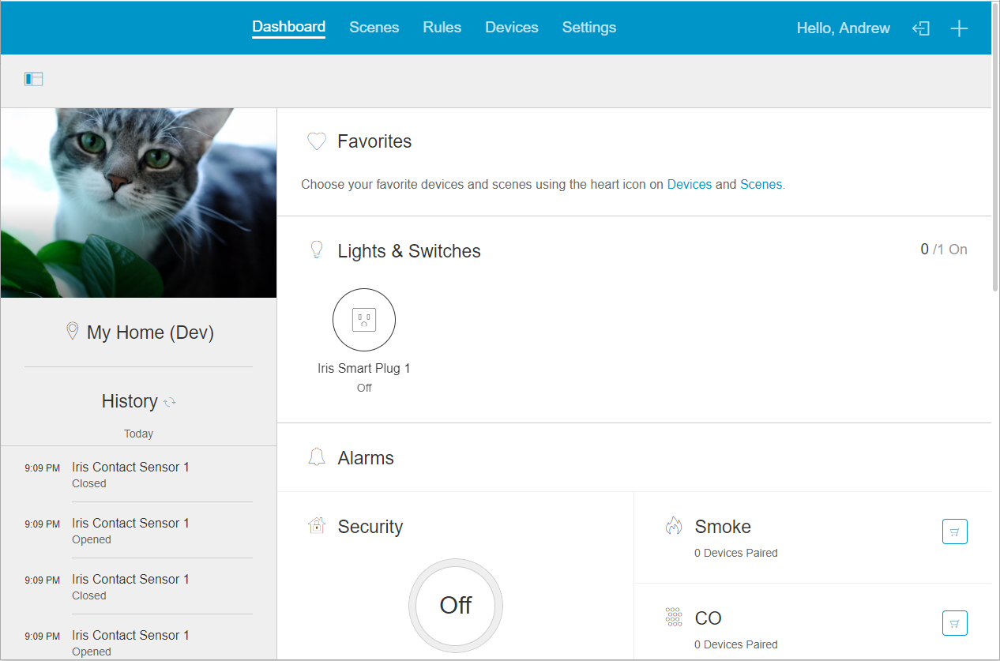

# Arcus - Web Application

The Arcus Web application is built on DoneJS. In order to utilize the Arcus Web application, you will need to have access to a running copy of Arcus Platform. 



## Getting started

Install git and clone the repository into a local folder.

Currently, the arcusweb project requires Node 8.x LTS and NPM > v3. It is recommended that you install [NVM](https://github.com/creationix/nvm) so you can easily switch between NPM versions. After installing NVM, run:

```
cd arcusweb
nvm install
nvm use
```

Install all dependencies using

```
npm install donejs@1.0 -g
npm install
npm run bundle-dev
```

## Running tests/linting

Tests and ESLint can be run with

```
npm run test
```

If you experience issues running tests in headless chromium (e.g. they never complete), you may need to execute:

`sudo sysctl -w kernel.unprivileged_userns_clone=1`

## Development mode

The first time, add a host entry for:

```
127.0.0.1 localdev.arcussmarthome.com
```

Then create a certificate:
`openssl genrsa -out bin/localhost.key 2048`
`openssl req -new -x509 -key bin/localhost.key -out bin/localhost.cert -days 3650 -subj /CN=localdev.arcussmarthome.com`

Development mode can be started with:

```
donejs develop
```
or:
```
npm run develop
```

and navigating to

```
https://localdev.arcussmarthome.com:8443
```

## Build and production mode

To build the application into a production bundle run:

```
npm run build
```

In Unix environment the production application can be started like this, though note that the built in web server is not ideal for use in production:

```
npm run start
```

If you run into problems with npm run start, you may need to create a couple folders:
```
mkdir build
cd build
mkdir dist
cd ..
npm run start
```

## Building containers for production

`./gradlew :tools:khakis:distDocker`

To tag and push the ui-server image to a registry:

`REGISTRY_NAME=<registry> ./gradlew :tools:khakis:pushDocker`

The build runs on the JDK pinned in `gradle/gradle-daemon-jvm.properties` (Java 21), regardless of `JAVA_HOME`. If no matching JDK is installed, Gradle downloads one.

## Passkeys

People can log in with a passkey instead of their password, and add or remove passkeys under Settings > Profile. The web app offers passkeys only when the ui-server container is started with `ARCUS_ENABLE_PASSKEYS=1` and the browser supports them. Set it only when the platform's client-bridge has `passkey.rp.id` set (see `docs/security.md` in arcusplatform). Passkeys are bound to that domain, so the web app must be served from it or one of its subdomains, and its origin must be listed in `passkey.origins`.
